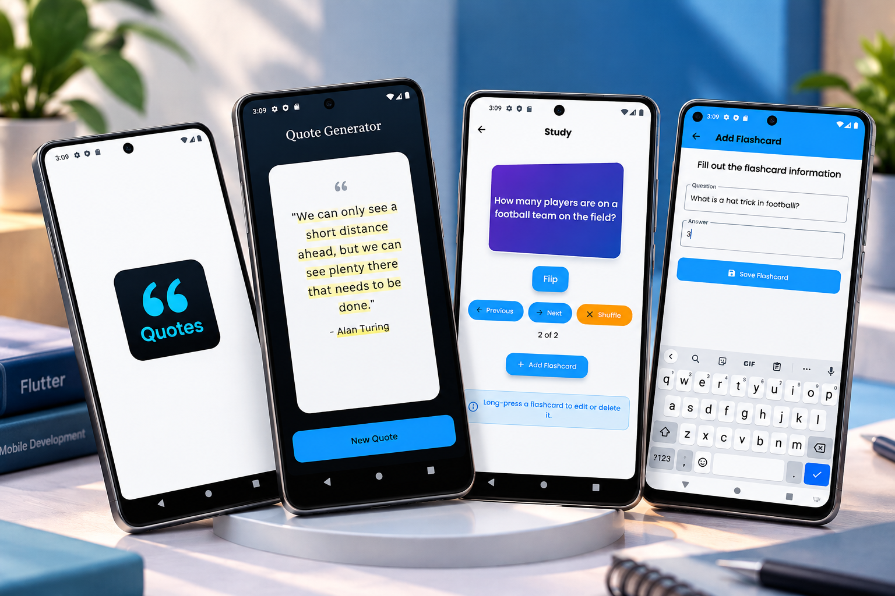

<div align="center">

# 🧠 Flashcard Quiz & Random Quote Generator

### Flutter • Dart • Interactive Learning • Productivity

A modern Flutter project featuring two applications:
an **interactive Flashcard Quiz** for studying and
memorization, and a **Random Quote Generator** for
discovering inspirational quotes.


</div>

---

## 📸 Project Preview

<div align="center">

<a href="1c6b5f23-aa17-4280-836f-522a3f2eec49.png">
  
</a>

</div>

---

## 📖 About the Project

This project showcases two Flutter applications
developed to explore interactive UI design,
state management, and user-friendly mobile
experiences.

### 🧠 Flashcard Quiz App

An educational application that helps users
study and memorize information using
interactive question-and-answer flashcards.

### 💬 Random Quote Generator

A productivity-inspired application that
displays motivational and inspirational
quotes through a clean, elegant interface.

---

## ✨ Flashcard Quiz Features

### 📚 Interactive Flashcards

- Display question-and-answer flashcards.
- Flip flashcards to reveal answers.
- Navigate between flashcards.
- Shuffle flashcards for randomized study.
- Track the current flashcard position.

### ➕ Flashcard Management

- Create new flashcards.
- Enter custom questions and answers.
- Save flashcards.
- Edit existing flashcards.
- Delete flashcards.

### 🎯 Study Experience

- Interactive study interface.
- Previous and Next navigation.
- Flip animation or interaction.
- Flashcard shuffle functionality.
- Simple and intuitive controls.

### 🎨 User Interface

- Modern blue-themed design.
- Clean flashcard layouts.
- Rounded action buttons.
- Responsive mobile screens.
- Easy-to-read questions and answers.

---

## 💬 Random Quote Generator Features

### ✨ Inspirational Quotes

- Display inspirational quotes.
- Generate a new quote with one tap.
- Show quote authors.
- Present quotes in a readable layout.

### 🎨 Modern Quote UI

- Elegant dark-themed interface.
- Minimalist quote cards.
- Highlighted quote text.
- Clean typography.
- Simple New Quote interaction.

---

## 📱 Application Screens

| Screen | Description |
|--------|-------------|
| Quote Welcome | Quote Generator splash screen |
| Quote Generator | Inspirational quotes and authors |
| Flashcard Study | Interactive question-and-answer cards |
| Add Flashcard | Create a custom flashcard |

---

## 🛠️ Technologies Used

| Technology | Purpose |
|------------|---------|
| Flutter | Mobile UI development |
| Dart | Application logic |
| Material Design | UI components |
| SQLite / JSON | Data handling, depending on implementation |
| Git | Version control |
| GitHub | Source code hosting |

---

## 🏗️ Application Overview

```text
      Flutter Applications
               |
      +--------+--------+
      |                 |
      v                 v
 Flashcard Quiz    Quote Generator
      |                 |
      v                 v
  Study Screen       Quote Screen
      |                 |
  +---+---+             v
  |       |         New Quote
  v       v
Flip    Navigate
  |
  v
Reveal Answer

Flashcard Management
      |
  +---+---+
  |   |   |
 Add Edit Delete
```

---

## 🔄 Flashcard Study Workflow

```text
       Open Flashcard App
                |
                v
          Study Screen
                |
                v
         Display Question
                |
                v
           Flip Card
                |
                v
          Reveal Answer
                |
                v
       Previous / Next
                |
                v
       Continue Studying
```

---

## 🎨 UI Design Highlights

### Flashcard Quiz

- Bright blue action buttons.
- Purple-to-blue flashcard gradients.
- Clean white backgrounds.
- Rounded cards and controls.
- Simple study navigation.

### Random Quote Generator

- Dark navy background.
- Large quote display card.
- Highlighted quote content.
- Minimal action buttons.
- Elegant typography.

---

## 🚀 Getting Started

### Prerequisites

Install:

- Flutter SDK
- Dart SDK
- Android Studio or VS Code
- Git

### 1. Clone the Repository

```bash
git clone <YOUR_REPOSITORY_URL>
```

Replace the placeholder with your actual
GitHub repository URL.

### 2. Open the Project

```bash
cd <YOUR_PROJECT_FOLDER>
```

### 3. Install Dependencies

```bash
flutter pub get
```

### 4. Run the Application

```bash
flutter run
```

If the Flashcard Quiz and Quote Generator
are stored in separate repositories,
clone and run each application independently.

---

## 💡 Development Highlights

This project demonstrates experience in:

- Flutter mobile development.
- Interactive UI components.
- Application state management.
- CRUD operations for flashcards.
- Question-and-answer interfaces.
- Navigation and user interactions.
- Working with structured data.
- Responsive mobile UI design.

---

## 🎯 Project Goals

- Build practical educational applications.
- Improve Flutter development skills.
- Create interactive study experiences.
- Implement flashcard management.
- Develop a clean quote generation interface.
- Practice state management and data handling.

---

## 👨‍💻 Developer

**Ahmed Jaber Ahmed**

Flutter Developer | Mobile App Developer

B.Sc. Computer Science & Artificial Intelligence

📍 Cairo, Egypt

- [GitHub](https://github.com/AhmedJaberAhmed)
- [Portfolio](https://ahmedjaberahmed.github.io/Jaber-website/)
- [LinkedIn](https://www.linkedin.com/in/ahmedjaberahmed/)

---

<div align="center">

### ⭐ Support the Project

If you find these applications interesting,
consider giving the project a star!

**Built with Flutter 💙**

</div>
